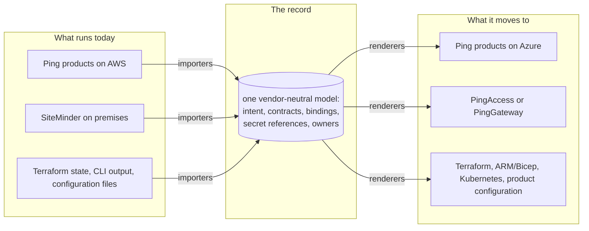

# Moving a platform: how migrations work

*How CIAMstack moves an identity platform to another cloud, account, region or product through one vendor-neutral record, what it does along the way, and what still needs engineering outside it. The commands are in [`opsdir/README.md`](../opsdir/README.md#migration-workspaces); the planner's reports are in [`REPORTS.md`](REPORTS.md); the design rationale is in [`ops-directory-model.md`](ops-directory-model.md#6-moving-between-environments).*

---

## 1. One model in the middle

A classic migration tool converts one product on one cloud into another product on another cloud. Every new pair of source and target needs its own conversion, so the work grows with the number of combinations.

CIAMstack converts through the record instead. Source adapters read the running platform into the record's vendor-neutral model, and target adapters render the target from the same model:

Each adapter is written once, for its own product or cloud, and works with every other adapter. Adding a product or a cloud means adding one adapter, not a converter for each pair it could meet. A move is possible wherever an adapter exists for each product and platform on both sides: an importer for the source, a renderer for the target.

Because the record keeps the **identity technology** (which products, how they are configured, who depends on them) apart from the **infrastructure** it runs on (cloud, accounts, regions, networks, secret stores), the same framework covers every kind of move:

| Kind of move | What changes | Example |
|---|---|---|
| **Lift-and-shift** | The infrastructure: cloud, account or region. The products stay. | PingDS and PingFederate on AWS move to Azure, unchanged |
| **Platform change** | How the products run | Virtual machines to Kubernetes, with the directory staying on virtual machines |
| **Product change** | One or more products. The infrastructure may stay. | SiteMinder applications move to PingAccess or PingGateway; an identity service moves onto a cloud-managed one |
| **Version upgrade** | Product versions, within the adapters' supported range | The planner names the vendor's changes between the two versions that affect the record |
| **Any combination** | Several of the above at once | A move to another cloud that also retires a product |

## 2. What travels and what is rebuilt

Every attribute in the record's schema declares what kind of value it is. That decides how it reaches the target:

| Kind | Examples | In the target |
|---|---|---|
| **Intent** | directory schema, indexes, ACIs, password policies, federation connections, OAuth clients, journeys, sync mappings, access rules | Rendered from the same entries. Configuration meant to be identical across environments renders **byte-identical**. |
| **Contract** | service DNS names, SAML entity IDs, OIDC issuers, redirect URIs | Rendered unchanged. The planner blocks a target that would change one. |
| **Binding** | hostnames, addresses, subnets, load balancers, firewall rules, sizes, key-store references | Declared for the target. A new environment is mostly a new set of bindings. |
| **Secret reference** | where a key, password or keystore is kept | Never stored. The target's references point at its own secret store and are resolved at run time. |
| **User data** | people, groups, password hashes | Never held by CIAMstack. Moves through the product's own replication: new directory replicas join the existing deployment. The record holds only its shape (counts, schemes, idle accounts). |
| **Observed** | live snapshots, access logs, inventories | Read again from the target after the move, to compare with the record. |

## 3. Step by step

1. **Operate from the record first.** The source platform is in the record and has been verified against reality ([onboarding](../README.md#bringing-it-into-an-organization)).
2. **Copy the record into a workspace.** `opsdir workspace create`. The platform keeps being operated from the live record while the move is prepared.
3. **Declare the target in the workspace:** its cloud and regions, its stack (which adapter fills each role, at which versions) and its bindings. Every write is governed, as in the live record.
4. **Plan.** `opsdir plan <from> <to>` compares the target with the source and gives a verdict, `READY` or `NOT READY`, with every blocker and action, each with an owner and, for actions, a do-by date from its lead time.
5. **Resolve what it finds.** Change the record, apply an offered fix after approval, answer an open question, draft a request to another team, or accept a finding through an approved risk exception. Then plan again.
6. **Render the target.** `opsdir render <cloud>/<env>` writes its Terraform, ARM/Bicep or CloudFormation, Kubernetes values, product configuration and scripts, with a manifest of hashes.
7. **Run it end to end.** `opsdir migrate <from> <to>` checks both stacks, plans and renders, and exits non-zero while blockers remain.
8. **Rehearse in stage.** Passing means the record and the renders are consistent. Operational readiness is proven by deploying to a stage environment and testing it there.
9. **Cut over.** `opsdir workspace cutover` applies the workspace's changes to the live record as one approved change. It is a three-way merge: changes made to the live record meanwhile still apply, and if both sides changed the same entry the cutover is refused and names it.
10. **Confirm afterwards.** Collect from the target to confirm it matches the record. The source stays in the record until it is retired, and what a retired product held stays on the list until each item is handled.

It works in either direction.

## 4. Configuration portability is not the whole move

Translating configuration is one part of a move. A real move also involves networking, DNS, certificates, secrets, service dependencies, data replication, security controls and application cutover, and identity has to keep working for every user throughout. A configuration that imports and renders successfully isn't proof that the target behaves the same.

CIAMstack holds these as part of the record so the planner can see them, but it doesn't do all of them itself:

| Part of the move | What CIAMstack does | What stays outside it |
|---|---|---|
| **Networking** | Firewall rules, routes, private endpoints, egress sites and other parties' allowlists are entries. The planner finds missing ports between server roles, rules with no counterpart, weaker flow-log retention, and every outside allowlist still pinning the old addresses, with a drafted request to each party. | Other parties updating their allowlists; the network team applying what it keeps. |
| **DNS** | Service names are contracts and must not change. DNS records are rendered for the target, and a fix lowers a changing name's TTL ahead of the move. | Switching the name at cutover, by the team that runs the zone. |
| **Certificates** | Each certificate, its issuer and expiry are entries. The planner finds certificates expiring before cutover and what each one's replacement breaks. | Issuing certificates, by the CA. |
| **Keys and secrets** | Each credential records whether the target must receive the same material or may regenerate it, whether it may leave its store, and whether it must be HSM-protected. The planner checks each. | Moving the material, by the secret stores' owners. It never passes through CIAMstack. |
| **Service dependencies** | Applications, directory consumers and federation partners are entries with owners and a status per move (unknown, identified, contacted, tested, cut over). Access logs show who really binds. The census finds files that copy old hostnames, addresses or account IDs, line by line. | Changing each application, by its owner. |
| **Data replication** | The target's directory replicas join the existing replication deployment (same deployment ID, so encrypted data and backups stay readable). The interconnect is a binding and the replication path a required role. | The replication itself, by the directory. |
| **Security controls** | Audit trails, threat detection, vulnerability scanning, posture services, SIEM routing, data residency and FIPS endpoints are compared between source and target. | Running and tuning those services. |
| **Authentication behavior** | Contracts stay stable. Where a target product or managed service can't do what an integration needs (a protocol, grant, client authentication, signing algorithm), the planner says so as a blocker. A capability no documentation establishes is a blocker until the operator records the vendor's confirmation. | Proving behavior in stage: real sign-ins against the rendered target. |
| **Application cutover** | Each consumer's status and owner, and the drafted tickets to the owning teams. | Moving traffic and testing each application, by its owner. |

The planner's job is to make every part of the move visible before cutover, with an owner and a date, so nothing is found for the first time on cutover day.

## 5. How the plan reports

- **Blockers** stop the move: the verdict stays `NOT READY` and `opsdir migrate` exits non-zero.
- **Actions** are work to do before cutover, each with an owner and a do-by date.
- **Accepted** findings are ones an approved risk exception accepts. They are shown but not counted in the verdict.
- **Already in place** lists what each check found ready.
- **A check that can't run** is a blocker, not a pass: a plan never passes a check it couldn't run.

Where a finding has a known record change, the plan offers it as a fix that a person approves. [`PEOPLE-IN-CONTROL.md`](PEOPLE-IN-CONTROL.md) describes how decisions reach people.

## 6. What exists today

The workspaces, planner, fixes, migration runner and cutover are built and tested offline, in both directions. The [showcase](../examples/showcase/README.md) plans moving a fictional company's production from AWS to Azure, with AM, IDM, PingGateway and PingFederate moving onto Kubernetes, and its planted problems are all found by the planner. No move has yet been run against real products or cloud accounts ([what's verified](../examples/showcase/README.md#whats-verified-and-what-isnt)).

## 7. Questions to settle at the start

- Is the move a lift-and-shift of the existing products, or are products and architecture changing too?
- Which products, clouds and tools run on each side, and does an adapter exist for each?
- Which contracts (service names, entity IDs, issuers) must stay as they are, and which parties pin them?
- Who keeps the target's landing zone, network and DNS, and do they take generated infrastructure?
- Which stage environment will the rehearsal run in?
