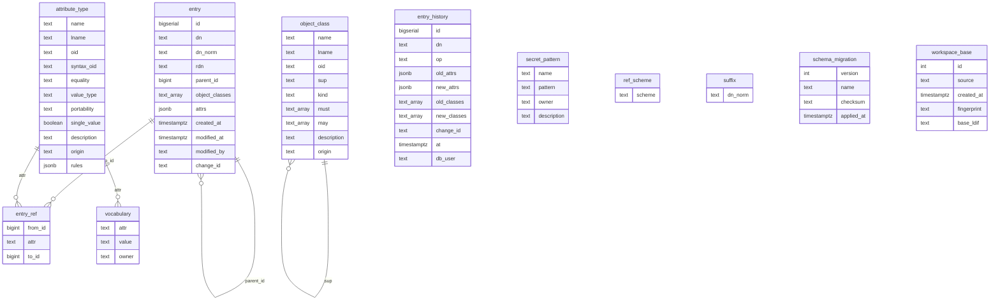

# The record's schema

*Generated from the schema fragments by `opsdir/scripts/gen-schema-docs.py`: don't edit by hand.*

How CIAMstack stores the platform's record, in two layers: a few PostgreSQL tables (the storage layer), and the entries those tables hold (the record layer), shaped like an LDAP directory. Every entry sits at a DN in one tree under `dc=ciam-ops`, has object classes that say which attributes it must and may have, and every attribute has a value type and a portability class. The published LDAP form of the same definitions is `opsdir/schema/ciam-ops.schema.ldif`; the rules the store enforces are in [`opsdir/SPEC.md`](../opsdir/SPEC.md).

This reference covers the core, its domains and the installed adapter packages that add definitions: 211 object classes and 961 attributes. Fields and record types an operator defines live in the record itself (`ou=custom-schema`, OIDs under `1.3.6.1.4.1.32473.4`), so they differ per record and aren't listed here.

## How to read it

- **Object classes** list their fields: *required* ones (MUST) and the rest (MAY). A class inherits its superclass's fields.
- **OIDs** are the arc of the part that defines them, then `.1.<n>` for attributes and `.2.<n>` for classes. The core and its domains share `1.3.6.1.4.1.32473.1`; each adapter package has its own arc.
- **Portability** says what happens to a value between environments and in a move: `intent` (the same everywhere), `contract` (names others depend on: must not change), `binding` (rewritten per environment), `secret-ref` (a reference to a secret, never the secret), `observed` (measured from the live system: evidence, never rendered), `meta` (ownership, status, dates, history). See SPEC §3.1.
- **Type** is stricter than an LDAP syntax: `string`, `int`, `bool`, `time` (`YYYYMMDDhhmmssZ`), `dn` (an entry of the record), `extdn` (a DN in another directory), `cidr`, `ip`, `fqdn`, `url`, `port`, `ref-uri` (a secret reference in a scheme an installed adapter owns), `json`, `enum` (the values listed) or `vocab` (the values installed domains and adapters declare). See SPEC §3.2.
- **Values** is single or multi-valued. **Rules** are checked on every value: `X-MIN`, `X-MAX`, `X-PATTERN`, `X-MAX-LENGTH`; `X-OVERRIDABLE` marks intent an environment may override.

## The storage layer (PostgreSQL)

The record is one PostgreSQL schema, `opsdir`. Every entry is a row of `entry`, its attributes a JSON object; the registry tables say what a valid entry is, and the store checks every write against them (triggers: schema, tree, references, vocabulary, value rules, no secret material, an approved change, the writer's grants) and appends it to `entry_history`. Views and report functions are re-created on every upgrade (`opsdir/store/sql/definitions`); the tables only change through a new migration (`opsdir/store/sql/migrations`).

### entry

Every entry of the record, one row each: its DN, parent, object classes and attributes.

| Column | Type | Holds |
| --- | --- | --- |
| `id` | `bigserial` | primary key |
| `dn` | `text` | the entry's DN as written |
| `dn_norm` | `text` | the DN normalized (lower case, no spaces around separators); unique |
| `rdn` | `text` | its first RDN |
| `parent_id` | `bigint` | the parent entry (an entry with children can't be deleted); none for a naming context |
| `object_classes` | `text[]` | its object classes, in the order written |
| `attrs` | `jsonb` | its attributes: {"attribute": ["value", ...]}, every value checked against the attribute's type, rules and vocabulary on write |
| `created_at` | `timestamptz` | when it was added |
| `modified_at` | `timestamptz` | when it was last written |
| `modified_by` | `text` | the login that last wrote it |
| `change_id` | `text` | the change record it was last written under (`cn=<change>,ou=changes`) |

### entry_ref

Every DN-valued attribute value that points at another entry: what keeps references intact (an entry something points at can't be deleted).

| Column | Type | Holds |
| --- | --- | --- |
| `from_id` | `bigint` | the entry holding the reference |
| `attr` | `text` | the attribute holding it |
| `to_id` | `bigint` | the entry it points at |

### entry_history

Append-only history: one row per write to an entry, never updated or deleted.

| Column | Type | Holds |
| --- | --- | --- |
| `id` | `bigserial` | primary key |
| `dn` | `text` | the entry written |
| `op` | `text` | add, modify or delete |
| `old_attrs` | `jsonb` | its attributes before |
| `new_attrs` | `jsonb` | its attributes after |
| `old_classes` | `text[]` | its object classes before |
| `new_classes` | `text[]` | its object classes after |
| `change_id` | `text` | the approved change it was written under |
| `at` | `timestamptz` | when |
| `db_user` | `text` | the login that wrote it (the session's own, whatever role it set) |

### attribute_type

The schema registry's attribute types: the standard LDAP ones the record uses and every one this reference lists, synced from the schema fragments on every upgrade.

| Column | Type | Holds |
| --- | --- | --- |
| `name` | `text` | canonical name (primary key) |
| `lname` | `text` | the name in lower case; unique |
| `oid` | `text` | its OID; unique |
| `syntax_oid` | `text` | the LDAP syntax |
| `equality` | `text` | the LDAP equality matching rule |
| `value_type` | `text` | X-VALUE-TYPE: what a value must look like |
| `portability` | `text` | X-PORTABILITY: intent, contract, binding, secret-ref, observed or meta |
| `single_value` | `boolean` | at most one value |
| `description` | `text` | what it holds |
| `origin` | `text` | the part that defines it |
| `rules` | `jsonb` | value rules beyond the type: X-MIN, X-MAX, X-PATTERN, X-MAX-LENGTH, X-OVERRIDABLE |

### object_class

The schema registry's object classes.

| Column | Type | Holds |
| --- | --- | --- |
| `name` | `text` | canonical name (primary key) |
| `lname` | `text` | the name in lower case; unique |
| `oid` | `text` | its OID; unique |
| `sup` | `text` | its superclass |
| `kind` | `text` | ABSTRACT, STRUCTURAL or AUXILIARY |
| `must` | `text[]` | the attributes an entry of the class must have |
| `may` | `text[]` | the attributes it may have |
| `description` | `text` | what it is |
| `origin` | `text` | the part that defines it |

### vocabulary

The values a `vocab` attribute accepts, each declared by an installed domain or adapter.

| Column | Type | Holds |
| --- | --- | --- |
| `attr` | `text` | the attribute |
| `value` | `text` | a value it accepts |
| `owner` | `text` | the domain or adapter that declares it |

### secret_pattern

The forms secret material takes, refused in every value (no secret is ever stored).

| Column | Type | Holds |
| --- | --- | --- |
| `name` | `text` | primary key |
| `pattern` | `text` | a regular expression |
| `owner` | `text` | the core, or the adapter that registers it |
| `description` | `text` | what it catches |

### ref_scheme

The reference schemes (`aws-sm://`, `vault://`, ...) the installed adapters own: a `ref-uri` value must use one.

| Column | Type | Holds |
| --- | --- | --- |
| `scheme` | `text` | primary key |

### suffix

The naming contexts: the roots of the tree (`dc=ciam-ops`).

| Column | Type | Holds |
| --- | --- | --- |
| `dn_norm` | `text` | primary key |

### schema_migration

The migrations applied, each once, with its checksum.

| Column | Type | Holds |
| --- | --- | --- |
| `version` | `int` | primary key |
| `name` | `text` | the migration's name |
| `checksum` | `text` | its SHA-256 when applied |
| `applied_at` | `timestamptz` | when |

### workspace_base

Only in a migration workspace database: the live snapshot it was copied from (one row).

| Column | Type | Holds |
| --- | --- | --- |
| `id` | `int` | always 1 |
| `source` | `text` | the live database it was copied from (no password) |
| `created_at` | `timestamptz` | when |
| `fingerprint` | `text` | SHA-256 of base_ldif |
| `base_ldif` | `text` | the live record as exported then |

## The record layer: the directory tree

```mermaid
flowchart LR
    dc_ciam_ops["dc=ciam-ops"]
    dc_ciam_ops --> ou_acis_dc_ciam_ops["ou=acis"]
    dc_ciam_ops --> ou_alert_rules_dc_ciam_ops["ou=alert-rules"]
    dc_ciam_ops --> ou_applications_dc_ciam_ops["ou=applications"]
    dc_ciam_ops --> ou_assessments_dc_ciam_ops["ou=assessments"]
    dc_ciam_ops --> ou_authorizations_dc_ciam_ops["ou=authorizations"]
    dc_ciam_ops --> ou_baselines_dc_ciam_ops["ou=baselines"]
    dc_ciam_ops --> ou_boundaries_dc_ciam_ops["ou=boundaries"]
    dc_ciam_ops --> ou_bundles_dc_ciam_ops["ou=bundles"]
    dc_ciam_ops --> ou_canaries_dc_ciam_ops["ou=canaries"]
    dc_ciam_ops --> ou_census_dc_ciam_ops["ou=census"]
    dc_ciam_ops --> ou_certificate_authorities_dc_ciam_ops["ou=certificate-authorities"]
    dc_ciam_ops --> ou_certificate_templates_dc_ciam_ops["ou=certificate-templates"]
    dc_ciam_ops --> ou_certificates_dc_ciam_ops["ou=certificates"]
    dc_ciam_ops --> ou_changes_dc_ciam_ops["ou=changes"]
    dc_ciam_ops --> ou_config_dc_ciam_ops["ou=config"]
    ou_config_dc_ciam_ops --> ou_declared_ou_config_dc_ciam_ops["ou=declared"]
    ou_config_dc_ciam_ops --> ou_observed_ou_config_dc_ciam_ops["ou=observed"]
    dc_ciam_ops --> ou_config_files_dc_ciam_ops["ou=config-files"]
    dc_ciam_ops --> ou_consumers_dc_ciam_ops["ou=consumers"]
    dc_ciam_ops --> ou_credentials_dc_ciam_ops["ou=credentials"]
    dc_ciam_ops --> ou_custom_schema_dc_ciam_ops["ou=custom-schema"]
    dc_ciam_ops --> ou_data_profile_dc_ciam_ops["ou=data-profile"]
    dc_ciam_ops --> ou_edge_policies_dc_ciam_ops["ou=edge-policies"]
    dc_ciam_ops --> ou_egress_destinations_dc_ciam_ops["ou=egress-destinations"]
    dc_ciam_ops --> ou_environments_dc_ciam_ops["ou=environments"]
    dc_ciam_ops --> ou_event_streams_dc_ciam_ops["ou=event-streams"]
    dc_ciam_ops --> ou_evidence_queries_dc_ciam_ops["ou=evidence-queries"]
    dc_ciam_ops --> ou_exceptions_dc_ciam_ops["ou=exceptions"]
    dc_ciam_ops --> ou_external_allowlists_dc_ciam_ops["ou=external-allowlists"]
    dc_ciam_ops --> ou_external_services_dc_ciam_ops["ou=external-services"]
    dc_ciam_ops --> ou_failover_drills_dc_ciam_ops["ou=failover-drills"]
    dc_ciam_ops --> ou_frameworks_dc_ciam_ops["ou=frameworks"]
    dc_ciam_ops --> ou_grants_dc_ciam_ops["ou=grants"]
    dc_ciam_ops --> ou_header_contracts_dc_ciam_ops["ou=header-contracts"]
    dc_ciam_ops --> ou_identity_services_dc_ciam_ops["ou=identity-services"]
    dc_ciam_ops --> ou_imports_dc_ciam_ops["ou=imports"]
    dc_ciam_ops --> ou_incidents_dc_ciam_ops["ou=incidents"]
    dc_ciam_ops --> ou_integrations_dc_ciam_ops["ou=integrations"]
    dc_ciam_ops --> ou_issued_certificates_dc_ciam_ops["ou=issued-certificates"]
    dc_ciam_ops --> ou_jobs_dc_ciam_ops["ou=jobs"]
    dc_ciam_ops --> ou_log_routes_dc_ciam_ops["ou=log-routes"]
    dc_ciam_ops --> ou_mail_senders_dc_ciam_ops["ou=mail-senders"]
    dc_ciam_ops --> ou_managed_certificates_dc_ciam_ops["ou=managed-certificates"]
    dc_ciam_ops --> ou_owners_dc_ciam_ops["ou=owners"]
    dc_ciam_ops --> ou_people_dc_ciam_ops["ou=people"]
    dc_ciam_ops --> ou_permission_sets_dc_ciam_ops["ou=permission-sets"]
    dc_ciam_ops --> ou_poam_dc_ciam_ops["ou=poam"]
    dc_ciam_ops --> ou_principals_dc_ciam_ops["ou=principals"]
    dc_ciam_ops --> ou_protected_applications_dc_ciam_ops["ou=protected-applications"]
    ou_protected_applications_dc_ciam_ops --> ou_access_rules_ou_protected_applications_dc_ciam_ops["ou=access-rules"]
    dc_ciam_ops --> ou_quotas_dc_ciam_ops["ou=quotas"]
    dc_ciam_ops --> ou_recovery_dc_ciam_ops["ou=recovery"]
    dc_ciam_ops --> ou_regions_dc_ciam_ops["ou=regions"]
    dc_ciam_ops --> ou_reporting_obligations_dc_ciam_ops["ou=reporting-obligations"]
    dc_ciam_ops --> ou_residencies_dc_ciam_ops["ou=residencies"]
    dc_ciam_ops --> ou_responsibilities_dc_ciam_ops["ou=responsibilities"]
    dc_ciam_ops --> ou_restore_tests_dc_ciam_ops["ou=restore-tests"]
    dc_ciam_ops --> ou_revocation_observations_dc_ciam_ops["ou=revocation-observations"]
    dc_ciam_ops --> ou_runbooks_dc_ciam_ops["ou=runbooks"]
    dc_ciam_ops --> ou_secret_inventory_dc_ciam_ops["ou=secret-inventory"]
    dc_ciam_ops --> ou_settings_dc_ciam_ops["ou=settings"]
    dc_ciam_ops --> ou_source_objects_dc_ciam_ops["ou=source-objects"]
    dc_ciam_ops --> ou_tag_policy_dc_ciam_ops["ou=tag-policy"]
    dc_ciam_ops --> ou_tickets_dc_ciam_ops["ou=tickets"]
    dc_ciam_ops --> ou_trust_bundles_dc_ciam_ops["ou=trust-bundles"]
    dc_ciam_ops --> ou_trust_policies_dc_ciam_ops["ou=trust-policies"]
    dc_ciam_ops --> ou_unknowns_dc_ciam_ops["ou=unknowns"]
    dc_ciam_ops --> ou_user_schema_dc_ciam_ops["ou=user-schema"]
    dc_ciam_ops --> ou_workloads_dc_ciam_ops["ou=workloads"]
```

The branches the core and its domains name, under the suffix `dc=ciam-ops`. Environments hold their own subtree (`env=<env>,cloud=<cloud>,ou=environments`, with `ou=bindings` for what is bound there); adapter packages add branches of their own (see their pages).

| Branch | Defined by |
| --- | --- |
| `ou=settings,dc=ciam-ops` | [Core](schema/core.md) |
| `ou=environments,dc=ciam-ops` | [Infrastructure](schema/infrastructure.md) |
| `ou=external-allowlists,dc=ciam-ops` | [Infrastructure](schema/infrastructure.md) |
| `ou=acis,dc=ciam-ops` | [Directory](schema/directory.md) |
| `ou=config,dc=ciam-ops` | [Directory](schema/directory.md) |
| `ou=declared,ou=config,dc=ciam-ops` | [Directory](schema/directory.md) |
| `ou=observed,ou=config,dc=ciam-ops` | [Directory](schema/directory.md) |
| `ou=consumers,dc=ciam-ops` | [Directory](schema/directory.md) |
| `ou=data-profile,dc=ciam-ops` | [Directory](schema/directory.md) |
| `ou=user-schema,dc=ciam-ops` | [Directory](schema/directory.md) |
| `ou=identity-services,dc=ciam-ops` | [Federation](schema/federation.md) |
| `ou=integrations,dc=ciam-ops` | [Federation](schema/federation.md) |
| `ou=certificate-authorities,dc=ciam-ops` | [PKI](schema/pki.md) |
| `ou=certificate-templates,dc=ciam-ops` | [PKI](schema/pki.md) |
| `ou=certificates,dc=ciam-ops` | [PKI](schema/pki.md) |
| `ou=credentials,dc=ciam-ops` | [PKI](schema/pki.md) |
| `ou=issued-certificates,dc=ciam-ops` | [PKI](schema/pki.md) |
| `ou=managed-certificates,dc=ciam-ops` | [PKI](schema/pki.md) |
| `ou=revocation-observations,dc=ciam-ops` | [PKI](schema/pki.md) |
| `ou=secret-inventory,dc=ciam-ops` | [PKI](schema/pki.md) |
| `ou=trust-bundles,dc=ciam-ops` | [PKI](schema/pki.md) |
| `ou=trust-policies,dc=ciam-ops` | [PKI](schema/pki.md) |
| `ou=applications,dc=ciam-ops` | [Governance](schema/governance.md) |
| `ou=changes,dc=ciam-ops` | [Governance](schema/governance.md) |
| `ou=grants,dc=ciam-ops` | [Governance](schema/governance.md) |
| `ou=imports,dc=ciam-ops` | [Governance](schema/governance.md) |
| `ou=incidents,dc=ciam-ops` | [Governance](schema/governance.md) |
| `ou=owners,dc=ciam-ops` | [Governance](schema/governance.md) |
| `ou=people,dc=ciam-ops` | [Governance](schema/governance.md) |
| `ou=runbooks,dc=ciam-ops` | [Governance](schema/governance.md) |
| `ou=source-objects,dc=ciam-ops` | [Governance](schema/governance.md) |
| `ou=tickets,dc=ciam-ops` | [Governance](schema/governance.md) |
| `ou=unknowns,dc=ciam-ops` | [Governance](schema/governance.md) |
| `ou=bundles,dc=ciam-ops` | [Configuration](schema/configuration.md) |
| `ou=census,dc=ciam-ops` | [Configuration](schema/configuration.md) |
| `ou=config-files,dc=ciam-ops` | [Configuration](schema/configuration.md) |
| `ou=jobs,dc=ciam-ops` | [Automation](schema/automation.md) |
| `ou=baselines,dc=ciam-ops` | [Compute](schema/compute.md) |
| `ou=workloads,dc=ciam-ops` | [Compute](schema/compute.md) |
| `ou=event-streams,dc=ciam-ops` | [Messaging](schema/messaging.md) |
| `ou=external-services,dc=ciam-ops` | [Messaging](schema/messaging.md) |
| `ou=mail-senders,dc=ciam-ops` | [Messaging](schema/messaging.md) |
| `ou=custom-schema,dc=ciam-ops` | [Custom](schema/custom.md) |
| `ou=alert-rules,dc=ciam-ops` | [Observability](schema/observability.md) |
| `ou=canaries,dc=ciam-ops` | [Observability](schema/observability.md) |
| `ou=log-routes,dc=ciam-ops` | [Observability](schema/observability.md) |
| `ou=permission-sets,dc=ciam-ops` | [Access](schema/access.md) |
| `ou=principals,dc=ciam-ops` | [Access](schema/access.md) |
| `ou=edge-policies,dc=ciam-ops` | [Edge](schema/edge.md) |
| `ou=header-contracts,dc=ciam-ops` | [Edge](schema/edge.md) |
| `ou=protected-applications,dc=ciam-ops` | [Web access](schema/webaccess.md) |
| `ou=access-rules,ou=protected-applications,dc=ciam-ops` | [Web access](schema/webaccess.md) |
| `ou=egress-destinations,dc=ciam-ops` | [Network](schema/network.md) |
| `ou=restore-tests,dc=ciam-ops` | [Data](schema/data.md) |
| `ou=failover-drills,dc=ciam-ops` | [Recovery](schema/recovery.md) |
| `ou=recovery,dc=ciam-ops` | [Recovery](schema/recovery.md) |
| `ou=assessments,dc=ciam-ops` | [Estate](schema/estate.md) |
| `ou=authorizations,dc=ciam-ops` | [Estate](schema/estate.md) |
| `ou=boundaries,dc=ciam-ops` | [Estate](schema/estate.md) |
| `ou=evidence-queries,dc=ciam-ops` | [Estate](schema/estate.md) |
| `ou=exceptions,dc=ciam-ops` | [Estate](schema/estate.md) |
| `ou=frameworks,dc=ciam-ops` | [Estate](schema/estate.md) |
| `ou=poam,dc=ciam-ops` | [Estate](schema/estate.md) |
| `ou=quotas,dc=ciam-ops` | [Estate](schema/estate.md) |
| `ou=regions,dc=ciam-ops` | [Estate](schema/estate.md) |
| `ou=reporting-obligations,dc=ciam-ops` | [Estate](schema/estate.md) |
| `ou=residencies,dc=ciam-ops` | [Estate](schema/estate.md) |
| `ou=responsibilities,dc=ciam-ops` | [Estate](schema/estate.md) |
| `ou=tag-policy,dc=ciam-ops` | [Estate](schema/estate.md) |

## The parts

| Part | Kind | OID arc | Object classes | Attributes |
| --- | --- | --- | --- | --- |
| [Core](schema/core.md) | core | `1.3.6.1.4.1.32473.1` | 2 | 8 |
| [Infrastructure](schema/infrastructure.md) | domain | `1.3.6.1.4.1.32473.1` | 20 | 76 |
| [Directory](schema/directory.md) | domain | `1.3.6.1.4.1.32473.1` | 16 | 76 |
| [Federation](schema/federation.md) | domain | `1.3.6.1.4.1.32473.1` | 6 | 35 |
| [PKI](schema/pki.md) | domain | `1.3.6.1.4.1.32473.1` | 20 | 118 |
| [Governance](schema/governance.md) | domain | `1.3.6.1.4.1.32473.1` | 14 | 68 |
| [Configuration](schema/configuration.md) | domain | `1.3.6.1.4.1.32473.1` | 5 | 18 |
| [Automation](schema/automation.md) | domain | `1.3.6.1.4.1.32473.1` | 2 | 15 |
| [Compute](schema/compute.md) | domain | `1.3.6.1.4.1.32473.1` | 5 | 42 |
| [Messaging](schema/messaging.md) | domain | `1.3.6.1.4.1.32473.1` | 5 | 26 |
| [Custom](schema/custom.md) | domain | `1.3.6.1.4.1.32473.1` | 3 | 24 |
| [Observability](schema/observability.md) | domain | `1.3.6.1.4.1.32473.1` | 8 | 40 |
| [Access](schema/access.md) | domain | `1.3.6.1.4.1.32473.1` | 5 | 16 |
| [Edge](schema/edge.md) | domain | `1.3.6.1.4.1.32473.1` | 8 | 45 |
| [Web access](schema/webaccess.md) | domain | `1.3.6.1.4.1.32473.1` | 3 | 23 |
| [Network](schema/network.md) | domain | `1.3.6.1.4.1.32473.1` | 9 | 37 |
| [Data](schema/data.md) | domain | `1.3.6.1.4.1.32473.1` | 6 | 43 |
| [Recovery](schema/recovery.md) | domain | `1.3.6.1.4.1.32473.1` | 3 | 11 |
| [Estate](schema/estate.md) | domain | `1.3.6.1.4.1.32473.1` | 29 | 132 |
| [PingAccess (opsdir-adapter-pingaccess)](schema/pingaccess.md) | package | `1.3.6.1.4.1.32473.3.5` | 8 | 15 |
| [PingAM (opsdir-adapter-pingam)](schema/pingam.md) | package | `1.3.6.1.4.1.32473.3.1` | 5 | 14 |
| [PingFederate (opsdir-adapter-pingfederate)](schema/pingfederate.md) | package | `1.3.6.1.4.1.32473.3.4` | 14 | 24 |
| [PingGateway (opsdir-adapter-pinggateway)](schema/pinggateway.md) | package | `1.3.6.1.4.1.32473.3.3` | 1 | 7 |
| [PingIDM (opsdir-adapter-pingidm)](schema/pingidm.md) | package | `1.3.6.1.4.1.32473.3.2` | 4 | 14 |
| [SiteMinder (opsdir-adapter-siteminder)](schema/siteminder.md) | package | `1.3.6.1.4.1.32473.3.6` | 10 | 34 |

## Standard LDAP definitions the record uses

Defined by the LDAP standards (RFC 4512, 4519, 4524), not by CIAMstack: the record uses them as the standards define them and adds a value type and a portability class to each attribute.

| Attribute | Type | Portability | Description |
| --- | --- | --- | --- |
| `objectClass` | `string` | meta | LDAP object classes |
| `cn` | `string` | meta | Common name / RDN |
| `ou` | `string` | meta | Organizational unit / RDN |
| `dc` | `string` | meta | Domain component / RDN |
| `description` | `string` | meta | Free text |
| `mail` | `string` | meta | Contact email |
| `telephoneNumber` | `string` | meta | Contact telephone number |

| Object class | Description |
| --- | --- |
| `top` | Top of the class hierarchy |
| `organizationalUnit` | Organizational unit |
| `domain` | Domain |
