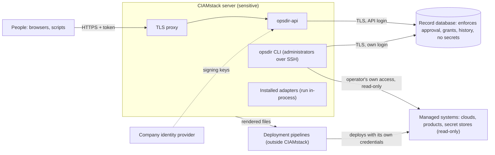

# Threat model

*What an attacker could do with each part of a CIAMstack deployment, where the security boundary is, what limits the damage, and what risk remains. CIAMstack understands and generates configuration for an organization's identity infrastructure, which makes it a valuable target: this document treats it that way. The controls themselves are described in [`SECURITY.md`](SECURITY.md).*

---

## 1. What is worth protecting

| Asset | Why it matters |
|---|---|
| **The record** | A complete map of the identity platform: servers, addresses, trust relationships, federation partners, access rules, dependencies, owners. No secret values, but very useful reconnaissance. |
| **The governance data** | Approvals, grants, people, settings and history. Whoever can change them can make an unapproved change look approved. |
| **Rendered files** | Terraform, product configuration and scripts that the company deploys. Tampering with them changes production. |
| **Credentials in use** | The operator's own cloud and product sessions on the CIAMstack server during collection, and references resolved in memory for one run. |
| **The CIAMstack server** | Runs the CLI, the API and collection, and holds the API's database login. |

## 2. Trust boundaries

- **The database is the enforcement boundary.** Approval, grants, history and the ban on secret values hold for every login that isn't the schema owner, whatever client connects.
- **The CIAMstack server is a sensitive host.** Whoever controls it controls the API's database login and sees the operators' sessions there.
- **Adapters are inside the server's boundary.** They are code running in the CIAMstack process, not sandboxed plug-ins.
- **Managed systems are outside it.** CIAMstack only reads them. It never deploys and holds no standing credentials for them.
- **Deployment is outside it.** Pipelines and operators deploy rendered files with their own credentials.

## 3. Threats

| Threat | What the attacker gets | What limits it | Residual risk, and what the operator does |
|---|---|---|---|
| **Compromised operator account** (a person's SSO or SSH access) | What that person's grants allow: proposing changes, applying approved ones in their area, reading the whole record | Nobody approves their own change. Grants limit actions to environments and owning teams, checked by the database. Production can require several approvers. Every write is in history under the person's name. | Reading the whole record is possible for any recorded person, by design. Two colluding approvers can approve anything in their area. Use the identity provider's MFA and conditional access, keep group membership tight, require more approvers for production, and review `opsdir history`. |
| **Compromised CIAMstack server** | The API's database login, so the ability to act as any recorded person through it, including approving as someone else; reading the record; the sessions of operators working on the server | The API login has only the runtime login's rights: it can't change the schema, the rules, the secret patterns or the history. Configuration on the server holds no secrets. The schema owner never signs in, and the migration login needn't be kept on the server. | **High.** Treat the server as a tier-0 asset: dedicated, hardened, patched, monitored, with administrator access limited and logged. Keep the migration login's credentials off it except during upgrades. Ship the database's own audit log off the host. Hardening so that a compromised API server can't approve as another person is planned. |
| **Compromised PostgreSQL account** | Depends on the login (next column) | The **runtime or a person's login**: every write still passes the rules; history can't be changed, removed or added to except by the store's own writes. The **API login**: as above. The **migration login or schema owner**: can change the rules themselves. | Keep the migration login with the DBA, signed in by certificate or Kerberos, used only for upgrades. Use database sign-in without passwords in the environment. A database superuser or the cloud provider's administrator can do anything: limit and audit those accounts as for any tier-0 database. |
| **Malicious or compromised adapter** | An adapter is Python code running in CIAMstack's process. It can read everything the process can: the whole record, and, during collection, the credentials resolved for that run and the operator's cloud sessions. It can write what the process's login can write. During `opsdir upgrade`, the process runs with the schema owner's rights. | Writes still pass the database's rules unless made during an upgrade. Installing an adapter is an administrator's act on the server. Each environment's declared stack names the adapters and versions it accepts, and `opsdir check` reports anything else. | **Adapters aren't sandboxed.** Install only adapters from sources the company trusts, at reviewed versions, from an internal package mirror with pinned hashes (`pip install --require-hashes`). Review an adapter's code like any software with access to the record. Loading only an allowlist of adapters by hash, and running collection out of process, are planned hardening. |
| **Compromised secret store** | The secrets in it | CIAMstack never holds secret values, so a CIAMstack compromise doesn't expose them and a store compromise doesn't expose CIAMstack. `opsdir report secret-inventory` finds references pointing at objects the store no longer holds. | The secret store's own controls (access policies, HSMs, rotation) protect it. The record helps after an incident: `opsdir report rotation-impact` shows what rotating each secret touches. |
| **Tampered imported configuration** (a forged or altered export) | Entries the attacker wants in the record | An import is previewed first and applied only under an approved change. Where it disagrees with the record, each difference is a conflict a person decides. Each imported file's SHA-256 is recorded on the import run, and a collected import records the identity the provider saw and a hash of every answer. XML with DOCTYPE or entity declarations is refused. Secret values are withheld. | An export that only adds plausible entries goes in as additions once its change is approved. Prefer `opsdir collect` (read straight from the system, with the identity checked) over uploaded exports, and review import previews before approving. |
| **Tampered rendered files** (between render and deploy) | Changed production configuration | Every render writes a manifest with each file's SHA-256, its scope, and who requested it. Renders are deterministic: rendering the same record again gives the same files, so anyone can re-render and compare. Rendered files carry a "do not edit" header. | The manifest isn't signed. Commit renders to a protected repository or sign them in the pipeline, and compare hashes before deploying. Signed manifests are planned. After deploying, collect again: drift shows anything that differs from the record. |
| **Supply-chain compromise** (a dependency, adapter or tool) | Code running with CIAMstack's rights | The core depends only on `psycopg` and `packaging`. Terraform fetched by `fetch-tools.sh` is checksum-verified. Vendor API specifications the PingFederate adapter checks against are kept in the repository. | Use pinned, hashed installs from an internal mirror. Signed releases and an SBOM aren't provided yet (planned). |
| **Privilege escalation** (a person granting themselves more) | More actions or a wider area | Grants, people, teams and settings are governed records: changing them needs the `settings` action and a change approved by someone else. Turning off approval separation fails `opsdir posture` on a production record. Database roles can't be changed by the runtime login. | Two colluding people holding `settings` could change grants. Keep `settings` with few people and review grant changes in history. |
| **Cross-company data exposure** | Another business's record | Each company runs its own record: a separate database on its own server, with its own logins and administrators. Nothing is shared between records. Exports and evidence packages name the record they came from. | A group that chooses to run several records on one database server owns that separation. Keep them on separate servers where boundaries matter. |
| **Replay or stale configuration** | The record acting on an old picture of the live system, or an old change re-applied | Import runs record when each export was taken. Fixes that must not act on a stale picture check that a recent enough import covers what they change. Workspace cutover is a three-way merge that refuses an entry changed on both sides. A change's approvals start over if what it proposes changes before it is applied, and its records can't be applied to an entry another change wrote after it was proposed. API tokens are checked for expiry and audience. | The export time of an uploaded export is the uploader's claim. Prefer collection for anything a fix depends on. |
| **Credential exfiltration** | Cloud, product or database credentials | No credential is stored by CIAMstack. Collection uses the operator's own login, or references resolved for one run, held in memory, passed on standard input or in CIAMstack's own request, with client certificates in anonymous memory files. Error output is masked. Evidence records which references were resolved, never values. The database is signed in to without passwords in the environment. | Credentials are in the server's memory while a collection runs: see "compromised CIAMstack server". Give collection logins read-only rights only, as each adapter's README lists. |
| **Malicious configuration input** (hostile values in the record) | Values crafted to break out of a rendered file or a command | Every value is typed and schema-checked by the database. Secret-shaped values are refused. Parsers of imported files report bad input instead of failing open. SSH collection runs only fixed commands on validated paths. Ansible lookups are written as escaped literals. | Secret references reach every command (at collection and in rendered setup scripts) through one quoting helper, each part exactly one argument. Every other value that reaches a rendered script, a product query or a command must be quoted or validated by the code that writes it, and a review of all renderers and collection commands for this is in progress. Until it lands, treat changes to values used in scripts as security-relevant in approval. |

## 4. Defense in depth, in short

1. **Approval by someone else** for every write, enforced in the database.
2. **Least privilege** for every login, with the schema owner never signing in.
3. **No secret values** in the record, renders, state, exports or evidence.
4. **No standing credentials** for managed systems, and read-only access to them.
5. **Separate records** per company.
6. **History of every write**, append-only and written only by the store, with author, approver, client and teams.
7. **Read-back after deploy**: collection turns any difference between the live system and the record into a finding.

## 5. Planned hardening

These are tracked as work, not built yet:

- tamper-evident history (a hash chain over history rows with a verify command), and guidance for shipping database audit logs off the host;
- signed render manifests;
- loading adapters only from an allowlist by hash, and running collection out of process;
- approvals that a compromised API server can't make on someone else's behalf;
- signed releases and an SBOM;
- a review of every renderer and collection command for quoting of record values.
